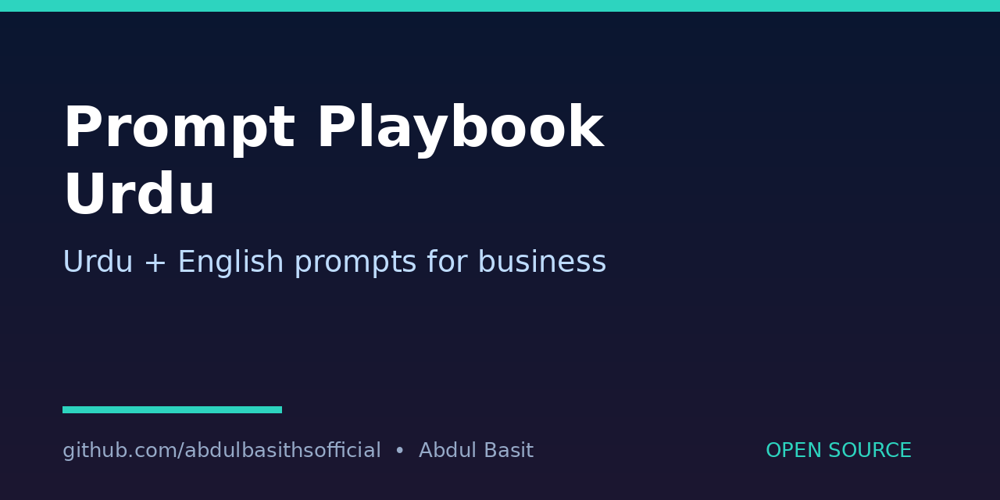

# PromptPlaybook-Urdu
Benefit: A bilingual Urdu/English prompt library for small businesses, organised by use-case, so owners can reuse good prompts for sales, support and social posts instead of writing from scratch each time.

## What it does
Lists prompts by use-case (sales, support, social) in English and Roman Urdu, and shows a full example for one prompt. Prompts are templates — replace the bracketed parts with your own business details.

## Quick start
```bash
python3 prompts.py --list
python3 prompts.py --use-case sales
python3 prompts.py --use-case support
```

## How to run
- `--list` shows all use-cases.
- `--use-case <sales|support|social>` prints that category's prompts.
- Edit `PROMPTS` in `prompts.py` to add your own prompts.
